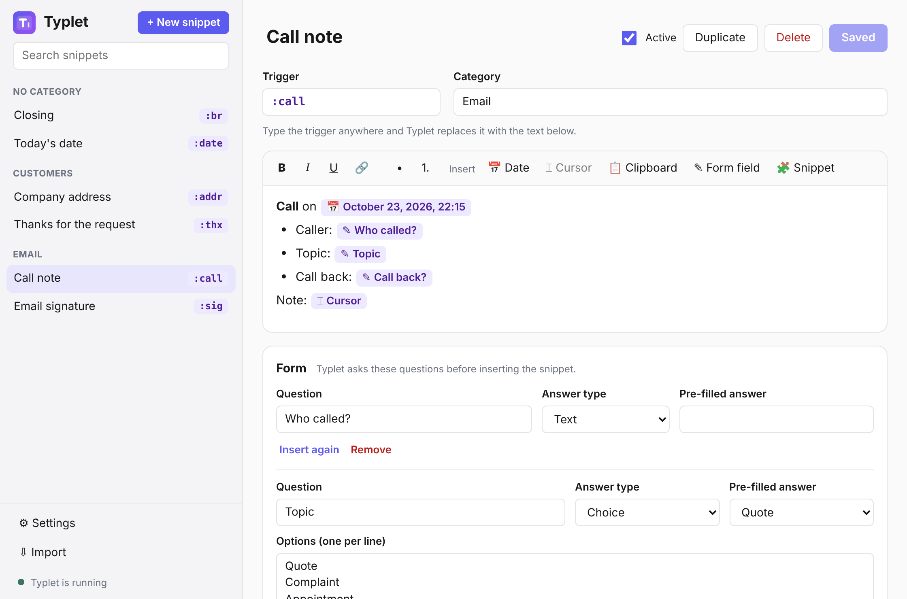
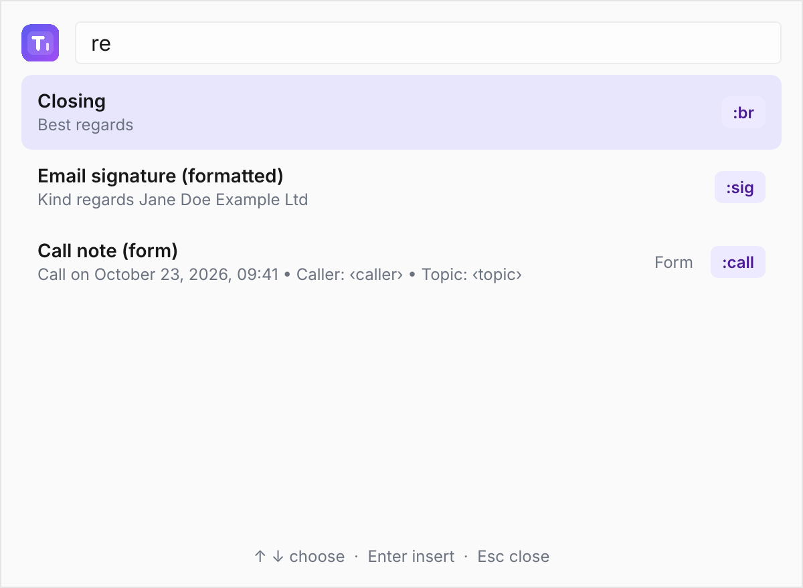
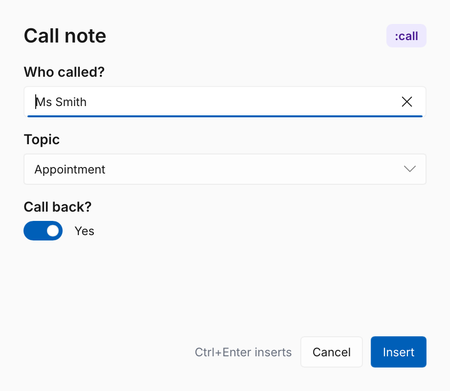
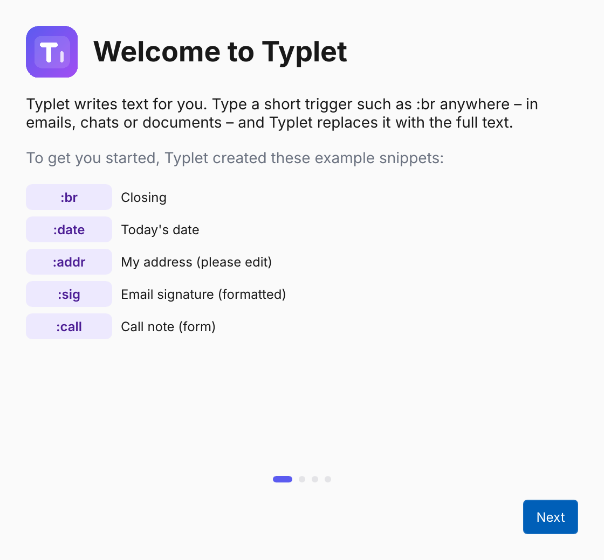
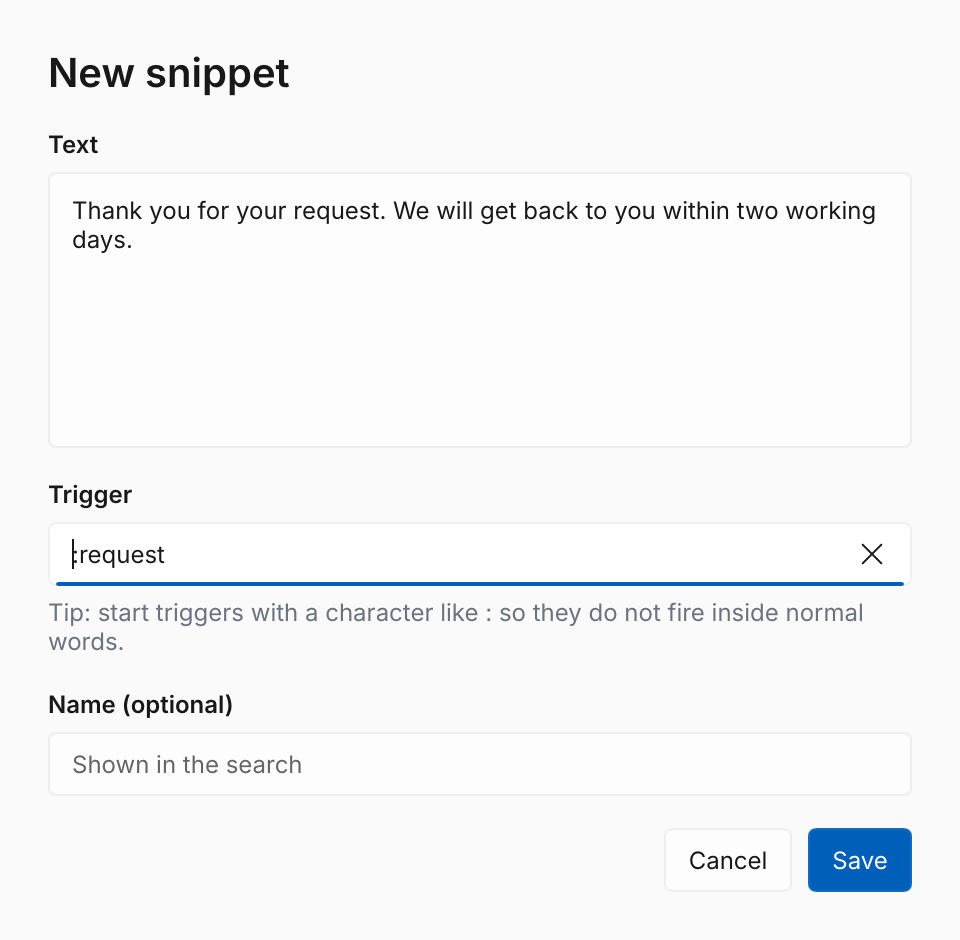
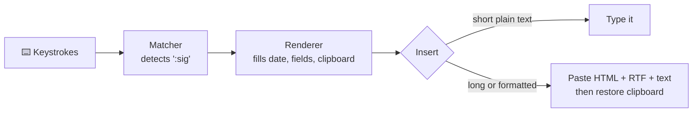

<div align="center">


# Typlet

**Type less. Say more.** ✨

A friendly, open-source text expander for everyone — not just power users.

[](https://github.com/typlet-app/typlet/actions/workflows/ci.yml)
[](LICENSE)


[](https://github.com/typlet-app/typlet/actions/workflows/build.yml)
[](rust-toolchain.toml)

[What is Typlet?](#-what-is-typlet) ·
[Download](#-download) ·
[Features](#-features) ·
[Screenshots](#-screenshots) ·
[User guide](docs/user-guide.md) ·
[Roadmap](docs/roadmap.md) ·
[Architecture](docs/architecture.md) ·
[Contributing](CONTRIBUTING.md)

</div>

> [!WARNING]
> Typlet is a **beta**. It works, but expect rough edges, and the installers are not code-signed yet.
> ⭐ Star or 👀 watch the repository to follow along, and [report what you find](https://github.com/typlet-app/typlet/issues/new/choose).

---

## 💡 What is Typlet?

You type a short abbreviation like `:sig`, and Typlet instantly replaces it with your full signature, today's date, a formatted e-mail footer or a fill-in form — **in any app**: your browser, Outlook, Word, Teams, WhatsApp, your CRM.

Tools like this already exist. The good free ones are powerful but expect you to edit configuration files; the easy ones are subscriptions. Typlet aims to be both: **free, open source and simple enough for anyone**.

## 📥 Download

Get the latest version from the **[releases page](https://github.com/typlet-app/typlet/releases)**:

| System | File |
|---|---|
| 🪟 Windows 10/11 | `Typlet_…_x64-setup.exe` — installs for your user, no admin rights |
| 🐧 Ubuntu, Debian | `Typlet_…_amd64.deb` |
| 🐧 Other Linux | `Typlet_…_amd64.AppImage` |

The [user guide](docs/user-guide.md#installing) ([Deutsch](docs/user-guide.de.md#installieren)) explains installing and the first steps. Builds of the latest development state are attached to every [CI run](docs/testing/test-build.md).

## 🤔 Why another text expander?

| | Typical free expander | Typlet |
|---|---|---|
| Creating a snippet | Edit a YAML/config file | ✍️ Visual editor with buttons for date, cursor, fields |
| Formatted text | Rarely, or via HTML in a config file | 🎨 Bold, italic, links and lists like in Word |
| Multi-line text | Breaks in some apps | 📋 Pasted reliably, clipboard restored afterwards |
| Forgot the abbreviation? | Look it up in the file | 🔎 Quick search window |
| Fill-in forms | Config syntax | 🧾 Fields, dropdowns and yes/no, built visually |
| Reusing parts | Nested variables in a config file | 🧩 Insert one snippet into another with a click |
| Setup | Manual | 🧭 Guided assistant with a test field |
| Privacy | Varies | 🔒 Local only, no network in the keystroke process |

## ✨ Features

**Legend:** ✅ done · 🚧 in progress · 🗺️ planned for V1

| Feature | Status |
|---|---|
| 📦 Snippet format with formatting, placeholders and form fields | ✅ |
| 🖨️ Output as plain text, HTML, RTF and Windows `CF_HTML` | ✅ |
| ⚡ Instant trigger matching, longest match wins, backspace to undo | ✅ |
| ⚠️ Detection of conflicting abbreviations (e.g. `:c` vs `:cc`) | ✅ |
| 💾 One file per snippet, folders as categories, crash-safe saving | ✅ |
| ⌨️ Keyboard engine for Windows and Linux (Wayland and X11) | ✅ |
| 📋 Smart insertion: typing for short text, pasting for long or formatted text, clipboard restored | ✅ |
| 💬 App rules: Shift+Enter in chat apps, plain text in Excel, longer delays for browsers | ✅ |
| 🔎 Quick search window and per-snippet hotkeys | ✅ |
| 🧾 Fill-in forms before insertion | ✅ |
| ✂️ New snippet from selected text | ✅ |
| 🧭 Set-up assistant with test field | ✅ |
| 🩺 Diagnostics with a privacy-safe report | ✅ |
| 🔐 Pause in password fields (Windows) | ✅ |
| 🌍 English and German interface | ✅ |
| ✍️ Visual snippet editor: formatting, placeholder chips, forms, live preview | ✅ |
| 🧩 Snippets inside snippets: write a signature once, use it everywhere | ✅ |
| ⚙️ Settings and app rules in the editor | ✅ |
| 📥 Import from espanso | ✅ |
| 📦 Installers: Windows (per user), Debian package, AppImage | ✅ |
| 🔏 Code signing and Microsoft Store | 🗺️ |

See the [roadmap](docs/roadmap.md) for milestones and what comes after V1 (macOS, sync, team libraries).

## 📸 Screenshots

**The editor** — formatting, today's date, form fields and the cursor position as chips, with a live preview:



| Quick search (`Ctrl+Shift+Space`) | Fill-in form |
|---|---|
|  |  |
| **Set-up assistant** | **New snippet from selection** (`Ctrl+Alt+S`) |
|  |  |

The interface is available in English and German ([German screenshots](docs/images/de)).

## 🧭 How it works



Typlet runs as a small native background program with a tray icon; a separate editor window opens only when you manage your snippets. Read more in [docs/architecture.md](docs/architecture.md).

## 🗂️ Repository layout

```text
typlet/
├── crates/
│   ├── typlet-core/      # Platform-independent core: format, matching, rendering, search, storage
│   ├── typlet-platform/  # Windows and Linux backends: keyboard, typing, clipboard, focus
│   ├── typlet/           # Background program: engine, tray, search, forms, set-up, diagnostics
│   ├── typlet-editor/    # Editor: Tauri + React + Tiptap (web interface in web/)
│   └── typlet-import/    # Import from espanso
├── docs/
│   ├── adr/              # Architecture decision records
│   ├── examples/         # Example snippet files (tested in CI)
│   ├── images/           # Screenshots (generated, English and German)
│   ├── testing/          # Test builds and the manual test checklist
│   ├── architecture.md · design.md · development.md
│   ├── roadmap.md · snippet-format.md
│   └── user-guide.md · user-guide.de.md
├── packaging/            # Installer configuration, Windows hooks, udev rule
├── scripts/              # Translation check, icon rendering, CI helpers
├── assets/               # Logo and artwork
└── .github/              # CI, test builds, issue and pull request templates
```

## 🛠️ Building from source

You need [Rust via rustup](https://rustup.rs). The exact compiler version is pinned in [`rust-toolchain.toml`](rust-toolchain.toml) and installed automatically. For the editor you also need [Node.js](https://nodejs.org) 22 or newer. On Linux, install `libxkbcommon-dev libfontconfig1-dev libwayland-dev libwebkit2gtk-4.1-dev libdbus-1-dev`.

```sh
git clone https://github.com/typlet-app/typlet.git
cd typlet
cargo test --workspace
cargo run -p typlet        # start the background program
```

The editor's development setup is described in [crates/typlet-editor](crates/typlet-editor/README.md).

More commands, platform notes and conventions are in [docs/development.md](docs/development.md).

## 🤝 Contributing

Contributions of all kinds are welcome: code, testing on your favourite apps, documentation, translations and ideas. Please read [CONTRIBUTING.md](CONTRIBUTING.md) first. Contributors sign a short [Contributor License Agreement](CLA.md) once, directly in the pull request.

## 🔒 Privacy and security

A text expander has to see what you type. These rules are built into Typlet:

- Only the last few characters are kept in memory, just enough to recognise an abbreviation ([matcher](crates/typlet-core/src/matcher.rs)).
- Nothing you type or insert is ever written to disk or logged; diagnostics record app names and outcomes only.
- The background program that sees your keystrokes has no network code.
- Typlet pauses automatically in password fields (Windows; GNOME does not expose them yet).
- Text Typlet puts on the clipboard stays out of the Windows clipboard history and cloud sync.

Found a vulnerability? Please report it privately as described in [SECURITY.md](SECURITY.md).

## 📜 License

Typlet is free software, licensed under the [GNU General Public License v3.0 or later](LICENSE).
The name and logo are covered by the [trademark policy](TRADEMARKS.md).

## 🙏 Acknowledgements

- [espanso](https://espanso.org) showed how powerful an open-source text expander can be and inspired this project.
- Built with [Rust](https://www.rust-lang.org), [Slint](https://slint.dev), [Tauri](https://tauri.app), [React](https://react.dev) and [Tiptap](https://tiptap.dev).
