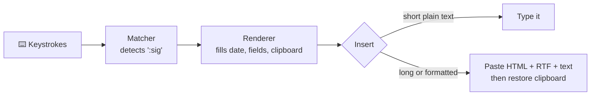

<div align="center">


# Typlet

**Type less. Say more.** ✨

A friendly, open-source text expander for everyone — not just power users.

[](https://github.com/typlet-app/typlet/actions/workflows/ci.yml)
[](LICENSE)


[](rust-toolchain.toml)

[What is Typlet?](#-what-is-typlet) ·
[Features](#-features) ·
[Roadmap](docs/roadmap.md) ·
[Architecture](docs/architecture.md) ·
[Contributing](CONTRIBUTING.md)

</div>

> [!WARNING]
> Typlet is in early development and **not usable yet**. There is no installable release.
> ⭐ Star or 👀 watch the repository to follow along.

---

## 💡 What is Typlet?

You type a short abbreviation like `:sig`, and Typlet instantly replaces it with your full signature, today's date, a formatted e-mail footer or a fill-in form — **in any app**: your browser, Outlook, Word, Teams, WhatsApp, your CRM.

Tools like this already exist. The good free ones are powerful but expect you to edit configuration files; the easy ones are subscriptions. Typlet aims to be both: **free, open source and simple enough for anyone**.

## 🤔 Why another text expander?

| | Typical free expander | Typlet |
|---|---|---|
| Creating a snippet | Edit a YAML/config file | ✍️ Visual editor with buttons for date, cursor, fields |
| Formatted text | Rarely, or via HTML in a config file | 🎨 Bold, italic, links and lists like in Word |
| Multi-line text | Breaks in some apps | 📋 Pasted reliably, clipboard restored afterwards |
| Forgot the abbreviation? | Look it up in the file | 🔎 Quick search window |
| Fill-in forms | Config syntax | 🧾 Fields, dropdowns and yes/no, built visually |
| Setup | Manual | 🧭 Guided assistant with a test field |
| Privacy | Varies | 🔒 Local only, no network in the keystroke process |

## ✨ Features

**Legend:** ✅ done · 🚧 in progress · 🗺️ planned for V1

| Feature | Status |
|---|---|
| 📦 Snippet format with formatting, placeholders and form fields | ✅ |
| 🖨️ Output as plain text, HTML, RTF and Windows `CF_HTML` | ✅ |
| ⚡ Instant trigger matching, longest match wins, backspace to undo | ✅ |
| ⚠️ Detection of conflicting abbreviations (e.g. `:c` vs `:cc`) | ✅ |
| 💾 One file per snippet, folders as categories, crash-safe saving | ✅ |
| ⌨️ Keyboard engine for Linux (Wayland) and Windows | 🗺️ |
| 📋 Smart insertion: typing for short text, pasting for long or formatted text | 🗺️ |
| 🔎 Quick search window and per-snippet hotkeys | 🗺️ |
| 🧾 Fill-in forms before insertion | 🗺️ |
| ✍️ Visual snippet editor | 🗺️ |
| 🧭 Setup assistant, diagnostics, pause in password fields | 🗺️ |
| 📥 Import from espanso | 🗺️ |

See the [roadmap](docs/roadmap.md) for milestones and what comes after V1 (macOS, sync, team libraries).

## 📸 Screenshots

Typlet does not have a user interface yet. Screenshots of the editor, the quick search and the setup assistant will appear here as soon as they exist.

## 🧭 How it works



Typlet will run as a small native background program; a separate editor window opens only when you manage your snippets. Read more in [docs/architecture.md](docs/architecture.md).

## 🗂️ Repository layout

```text
typlet/
├── crates/
│   └── typlet-core/     # Platform-independent core: format, matching, rendering, storage
├── docs/
│   ├── adr/             # Architecture decision records
│   ├── examples/        # Example snippet files (tested in CI)
│   ├── architecture.md
│   ├── development.md
│   ├── roadmap.md
│   └── snippet-format.md
├── assets/              # Logo and artwork
└── .github/             # CI, issue and pull request templates
```

## 🛠️ Building from source

You need [Rust via rustup](https://rustup.rs). The exact compiler version is pinned in [`rust-toolchain.toml`](rust-toolchain.toml) and installed automatically.

```sh
git clone https://github.com/typlet-app/typlet.git
cd typlet
cargo test --workspace
```

More commands, platform notes and conventions are in [docs/development.md](docs/development.md).

## 🤝 Contributing

Contributions of all kinds are welcome: code, testing on your favourite apps, documentation, translations and ideas. Please read [CONTRIBUTING.md](CONTRIBUTING.md) first. Contributors sign a short [Contributor License Agreement](CLA.md) once, directly in the pull request.

## 🔒 Privacy and security

A text expander has to see what you type. These are binding design rules for the keyboard engine, which is still being built:

- Only the last few characters are kept in memory, just enough to recognise an abbreviation (already true for the [matcher](crates/typlet-core/src/matcher.rs)).
- Nothing you type is ever written to disk or logged.
- The process that sees your keystrokes has no network access.
- Typlet pauses automatically in password fields.

Found a vulnerability? Please report it privately as described in [SECURITY.md](SECURITY.md).

## 📜 License

Typlet is free software, licensed under the [GNU General Public License v3.0 or later](LICENSE).
The name and logo are covered by the [trademark policy](TRADEMARKS.md).

## 🙏 Acknowledgements

- [espanso](https://espanso.org) showed how powerful an open-source text expander can be and inspired this project.
- Built with [Rust](https://www.rust-lang.org); the user interface will use [Slint](https://slint.dev), [Tauri](https://tauri.app) and [Tiptap](https://tiptap.dev).
