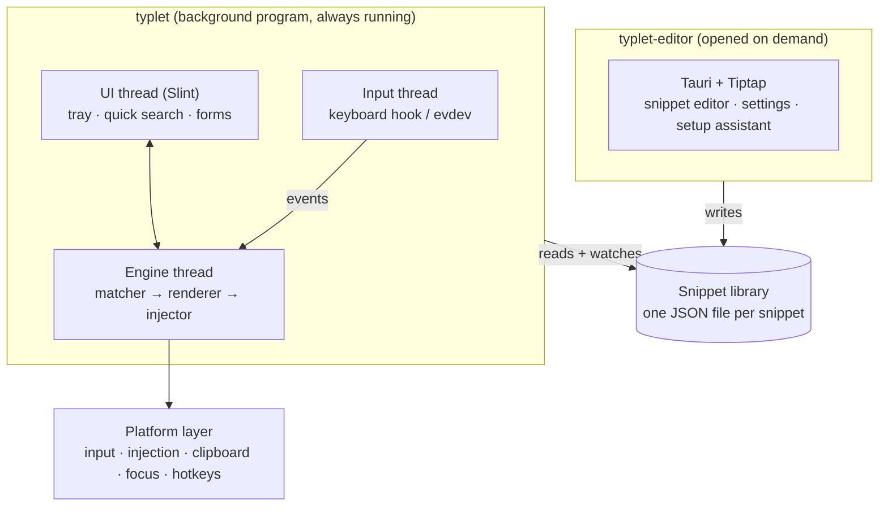
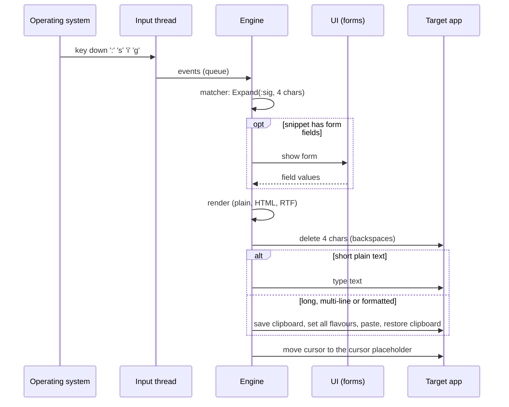

# 🏗️ Architecture

This document describes how Typlet is built and why. Decisions behind it are recorded in the [ADRs](adr/README.md).

> Status: the platform-independent core (`typlet-core`) exists. Everything else in this document is the agreed design for the components still to be built.

## Goals

1. **Simple for everyone.** No configuration files, no terminal. A visual editor and a setup assistant.
2. **Reliable in every app.** Multi-line and formatted text must arrive intact, the clipboard must survive.
3. **Small and trustworthy.** A text expander sees every keystroke. The part that does should be tiny, native, offline and auditable.
4. **Runs everywhere.** Windows first, Linux from V1, macOS after V1.

## Overview

### Components

| Component | Kind | Status | Responsibility |
|---|---|---|---|
| `typlet-core` | Library crate | ✅ exists | Snippet format, validation, trigger matching, rendering, storage. No OS access, no `unsafe`. |
| `typlet-platform` | Library crate | 🗺️ planned | One backend per OS: keyboard input, text injection, clipboard, focused-app detection, global hotkeys. |
| `typlet` | Binary | 🗺️ planned | The background program: wires core and platform together, shows tray, quick search and forms with Slint. |
| `typlet-editor` | Binary | 🗺️ planned | The editor window: Tauri with a Tiptap rich-text editor. Started only when needed. |

The two programs communicate through the **snippet library on disk**: the editor writes files, the background program watches the folder and reloads. No network sockets, no shared memory.

## Why two programs

The background program runs all day and sees every keystroke. It is native (Rust + Slint), contains **no browser engine** and **no network code**, and starts its windows instantly because they are created once and only hidden.

Rich-text editing is the one area where web technology is far ahead (Tiptap/ProseMirror). The editor is opened rarely, so it can use a webview without affecting memory use or the attack surface of the keystroke process. See [ADR 0002](adr/0002-native-background-process.md) and [ADR 0003](adr/0003-separate-editor-process.md).

## Threads in the background program

| Thread | Does | Must never |
|---|---|---|
| Input | Receives raw key events and pushes them into a lock-free queue | Block or do work. Windows silently removes keyboard hooks that respond too slowly. |
| Engine | Translates keys to characters, runs the matcher, renders, injects | Touch the UI directly |
| UI (main) | Tray menu, quick search, forms (Slint requires the main thread on macOS) | Run long tasks |

## Expansion pipeline

### Matching rules

Implemented in [`matcher.rs`](../crates/typlet-core/src/matcher.rs):

- Expansion is **instant**: the last character of the trigger fires it.
- The **longest** matching trigger wins.
- **Backspace right after an expansion undoes it.**
- The platform layer sends `Reset` whenever the typing position might have changed: mouse clicks, arrow keys, focus changes, shortcuts. The matcher never guesses across such events.
- The editor warns about triggers that can never fire (`:c` makes `:cc` unreachable).

### Insertion rules

Implemented in [`render/mod.rs`](../crates/typlet-core/src/render/mod.rs) (`Rendered::insert_method`):

| Content | Method | Reason |
|---|---|---|
| Short plain text (≤ 200 characters, one line) | Type | Works everywhere, does not touch the clipboard |
| Multi-line text | Paste | Typed line breaks are dropped by some apps and send messages in chat apps |
| Formatted text | Paste with HTML, RTF and plain text | Only the clipboard can carry formatting; the app picks the richest format it understands |
| Long text | Paste | Typing is slow |

Clipboard handling in the platform layer:

- The previous clipboard content is saved with **all formats** and restored after pasting.
- Restoring waits until the target app has read the clipboard; apps that read late (browsers, remote desktops) get longer delays via app profiles.
- Temporary content is marked as transient so clipboard history (Win+V) and clipboard managers ignore it.
- Formatted output carries **no fonts or colours**, so pasted text adopts the style of the document it lands in.

## Platform backends

| | Windows | Linux (Wayland) | macOS (after V1) |
|---|---|---|---|
| Keyboard input | Low-level keyboard hook | evdev (`/dev/input`), user in the `input` group | Event tap (Accessibility permission) |
| Characters from keys | Layout-aware translation that preserves dead keys (`^`, `´`) | xkbcommon with the user's layout | System layout APIs |
| Typing | Unicode `SendInput` | uinput virtual keyboard | Event posting |
| Clipboard | Win32 clipboard with `CF_HTML`, RTF, text | Wayland data device (to be validated on GNOME) | NSPasteboard |
| Focused app | Foreground window | AT-SPI or a small GNOME Shell extension | Accessibility API |
| Global hotkeys | `RegisterHotKey` | XDG desktop portal | Carbon / event tap |
| Tray | Slint system tray | StatusNotifierItem (Ubuntu ships the AppIndicator extension) | Menu bar extra |

Known limits: Windows blocks input into programs running as administrator unless Typlet is signed and installed with UIAccess. GNOME does not reveal the focused window without an extension, so app profiles on GNOME arrive after V1.

## Storage

Implemented in [`library.rs`](../crates/typlet-core/src/library.rs). A library is a folder; every snippet is a JSON file named after its UUID; sub-folders are categories. Files are written atomically (temporary file, then rename). A broken file is reported and skipped; it never blocks the rest. The format is specified in [snippet-format.md](snippet-format.md).

## Security and privacy model

| Rule | Where it is enforced |
|---|---|
| Keep only as many typed characters as the longest trigger | `Matcher` (core) |
| Never write keystrokes to disk or logs | Code review rule; no logging of input events |
| No network access in the background program | No network dependencies in its crates; `cargo-deny` in CI |
| Pause in password fields | Platform layer (UI Automation on Windows, secure input on macOS, AT-SPI on Linux) |
| Render links only for `http`, `https` and `mailto` | Renderer (core) |
| `typlet-core` contains no `unsafe` code | `#![forbid(unsafe_code)]` |

## Testing strategy

- **Core:** unit tests per module plus integration tests. The examples in [docs/examples](examples/) are loaded and rendered in CI, so the documentation cannot drift from the format.
- **Platform layer:** thin by design; tested manually against a matrix of the most-used applications (browsers, Office, Teams, WhatsApp, LibreOffice, Thunderbird, Slack, VS Code, terminals) on Windows and Linux.
- **CI:** formatting, clippy, tests on Linux and Windows, documentation build and `cargo-deny` on every push.
