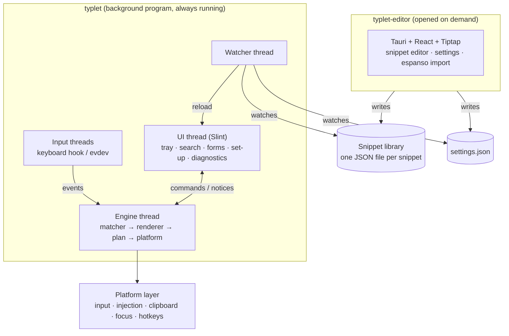
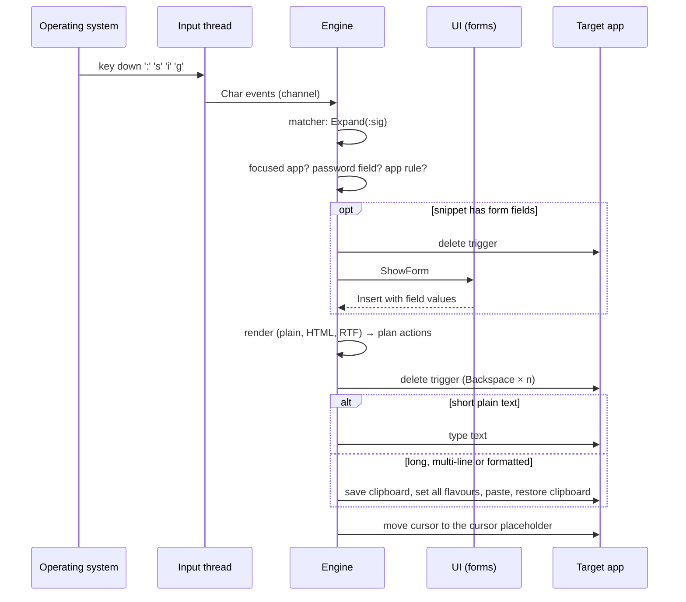
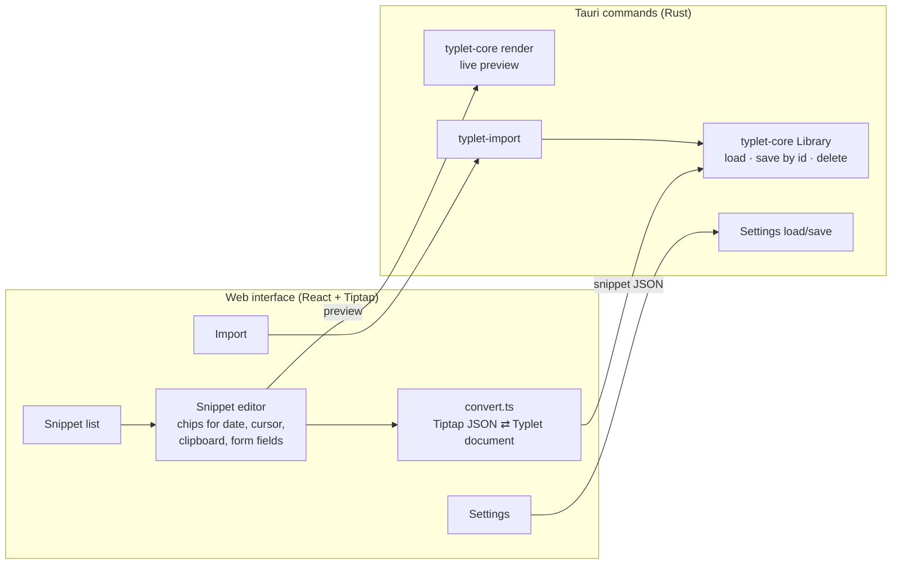

# 🏗️ Architecture

This document describes how Typlet is built and why. Decisions behind it are recorded in the [ADRs](adr/README.md).

> Status: the core, both platform backends, the background program and the editor exist. Installers and signing (milestone M5) are next.

## Goals

1. **Simple for everyone.** No configuration files, no terminal. A visual editor and a set-up assistant.
2. **Reliable in every app.** Multi-line and formatted text must arrive intact, the clipboard must survive.
3. **Small and trustworthy.** A text expander sees every keystroke. The part that does should be tiny, native, offline and auditable.
4. **Runs everywhere.** Windows first, Linux from V1, macOS after V1.

## Overview

### Components

| Component | Kind | Status | Responsibility |
|---|---|---|---|
| [`typlet-core`](../crates/typlet-core) | Library crate | ✅ | Snippet format, validation, matching, rendering, action plans, search, settings, storage. No OS access, no `unsafe`. |
| [`typlet-platform`](../crates/typlet-platform) | Library crate | ✅ | One backend per OS: keyboard input, text injection, clipboard, focused app, hotkeys, autostart, paths. |
| [`typlet`](../crates/typlet) | Binary | ✅ | The background program: engine thread, tray, quick search, forms, new snippet, set-up assistant, diagnostics. |
| [`typlet-editor`](../crates/typlet-editor) | Binary | ✅ | The editor window: Tauri with a React + Tiptap interface. Snippets, settings, espanso import. Started only when needed. |
| [`typlet-import`](../crates/typlet-import) | Library crate | ✅ | Converts espanso match files into Typlet snippets. Pure, no writing. |

The two programs communicate through **files**: the editor writes snippets and `settings.json`, the background program watches both and reloads. While the editor has the keyboard focus it holds a lock file, so the background program does not expand triggers typed into it ([ADR 0012](adr/0012-editor-focus-lock.md)). No network sockets, no shared memory. Starting either program also starts or shows the other: the editor launches the background program if it is not running, and a second start of the background program opens the editor.

## Why two programs

The background program runs all day and sees every keystroke. It is native (Rust + Slint), contains **no browser engine** and **no network code**, and starts its windows instantly because they are created once and only hidden.

Rich-text editing is the one area where web technology is far ahead (Tiptap/ProseMirror). The editor is opened rarely, so it can use a webview without affecting memory use or the attack surface of the keystroke process. See [ADR 0002](adr/0002-native-background-process.md) and [ADR 0003](adr/0003-separate-editor-process.md). The set-up assistant and diagnostics need live engine state and therefore live in the background program ([ADR 0010](adr/0010-setup-and-diagnostics-in-background-program.md)).

## Threads in the background program

| Thread | Does | Must never |
|---|---|---|
| Input (`typlet-hook` on Windows; one reader per device plus `typlet-translate` on Linux) | Reads key presses, translates them to characters, recognises hotkeys, pushes events into a channel | Block or do work. Windows silently removes keyboard hooks that respond too slowly. |
| Engine (`typlet-engine`) | Owns the platform backend: runs the matcher, renders, plans and executes insertions | Touch the UI directly |
| UI (main) | Tray menu and windows; owns settings and the loaded library | Run long tasks |
| Watcher (`typlet-watcher`) | Notices changed files, waits until writing has settled (300 ms) and asks the UI to reload | Parse snippets on behalf of the engine |

The UI sends **commands** to the engine (`Library`, `Settings`, `Insert`, `FormCancelled`, `RestoreFocus`, `Quiet`, `Diagnostics`, `Retry`, `Quit`) and receives **notices** (`Started`, `InputFailed`, `ShowSearch`, `ShowForm`, `Selection`, `InsertFailed`, `Diagnostics`). The engine is generic over the platform, so its logic is unit-tested with a fake backend ([`engine.rs`](../crates/typlet/src/engine.rs)).

## Expansion pipeline

### Matching rules

Implemented in [`matcher.rs`](../crates/typlet-core/src/matcher.rs) ([ADR 0007](adr/0007-instant-expansion.md)):

- Expansion is **instant**: the last character of the trigger fires it.
- The **longest** matching trigger wins.
- **Backspace right after an expansion undoes it** and restores the trigger ([`plan_undo`](../crates/typlet-core/src/plan.rs)). On Windows the Backspace is held back so the undo is exact; on Linux it reaches the app and the undo accounts for the deleted character. Formatted (pasted) snippets cannot be undone this way; Backspace then works normally.
- The platform layer sends `Reset` whenever the typing position might have changed: mouse clicks, arrow keys, Enter, Tab, focus changes, shortcuts, dead keys. The matcher never guesses across such events.
- Nothing expands while Typlet is paused, while a form is open, or while one of Typlet's own windows with text fields (search, form, new snippet) is open. The set-up assistant's test field is the deliberate exception.

### Before inserting

The engine asks the platform for the focused app and checks, in this order:

1. **Password field** (Windows, via UI Automation) → skip and record it.
2. **App rule** from the settings ([`settings.rs`](../crates/typlet-core/src/settings.rs)): Typlet can be switched off per app; rules can force typing or pasting, plain text only, Shift+Enter for line breaks, or a longer clipboard delay. Built-in rules cover Excel, chat apps (Teams, WhatsApp, Slack, Discord, Signal, Telegram), browsers and remote desktops; user rules override them.

### Insertion rules

Implemented in [`render/mod.rs`](../crates/typlet-core/src/render/mod.rs) (`Rendered::insert_method`) and [`plan.rs`](../crates/typlet-core/src/plan.rs):

| Content | Method | Reason |
|---|---|---|
| Short plain text (≤ 200 characters, one line) | Type | Works everywhere, does not touch the clipboard |
| Multi-line text | Paste | Typed line breaks are dropped by some apps and send messages in chat apps |
| Formatted text | Paste with HTML, RTF and plain text | Only the clipboard can carry formatting; the app picks the richest format it understands |
| Long text | Paste | Typing is slow |

A snippet's `insert_mode` overrides the automatic choice; an app rule overrides both.

Clipboard handling in the platform layer:

- The previous clipboard content is saved with **all formats** (Windows) and restored after pasting, unless another program changed the clipboard in the meantime (checked with the clipboard sequence number).
- Restoring waits until the target app has read the clipboard: 300 ms by default, longer for browsers and remote desktops via app rules.
- Temporary content is marked as transient (`ExcludeClipboardContentFromMonitorProcessing`, `CanIncludeInClipboardHistory = 0`, `CanUploadToCloudClipboard = 0`), so Win+V history and cloud clipboard ignore it.
- The clipboard is opened without an owner window, so other programs never wait for Typlet's engine thread.
- Formatted output carries **no fonts or colours**, so pasted text adopts the style of the document it lands in.
- Before injecting, the platform waits until the user has released modifier keys, so held keys do not combine with simulated ones.

## Windows of the background program

| Window | Opened by | Notes |
|---|---|---|
| Tray menu | Always present | Search, new snippet, editor, snippet folder, pause, start with the computer, set-up, diagnostics, help, quit |
| Quick search | `Ctrl+Shift+Space`, tray click | Frameless, on top, centred near the mouse; Enter inserts into the previously focused app |
| Form | A snippet with fields | The trigger is removed first; cancelling types it back |
| New snippet | `Ctrl+Alt+S` with selected text, tray | Validates the trigger live (empty, spaces, too long, already used) |
| Set-up assistant | First start, tray | Welcome, permission check, test field, start-up option ([ADR 0010](adr/0010-setup-and-diagnostics-in-background-program.md)) |
| Diagnostics | Tray, error messages | Live status, library problems, last 20 expansions, a copyable report without typed text |
| Messages | Errors and notices | Texts are translated in the UI; the program only passes a kind and details |

Focus: when a window opens, the platform remembers the focused window (on Windows the last window of another program the user typed in, if the tray was clicked) and gives the focus back before inserting.

All windows share design tokens ([`theme.slint`](../crates/typlet/ui/theme.slint), [design.md](design.md)) and follow light and dark mode. Texts are English in the source and translated with bundled gettext catalogues ([ADR 0011](adr/0011-interface-translations.md)).

## The editor

- The interface edits snippets in the **file format itself** (TypeScript types in [`types.ts`](../crates/typlet-editor/web/src/types.ts)); only the rich-text part is converted to and from Tiptap ([`convert.ts`](../crates/typlet-editor/web/src/convert.ts)). Tiptap is configured with exactly the formatting a snippet can hold; pasted Word or web content is reduced to that.
- **All file access happens in Rust** through `typlet-core` ([`commands.rs`](../crates/typlet-editor/src/commands.rs)). The interface addresses snippets by id and categories by name; it never handles file paths for snippets. Category names are validated so they cannot escape the library folder.
- The **preview** is rendered by the same Rust code that inserts snippets, so what the user sees is what gets inserted.
- Trigger problems (empty, spaces, duplicates, triggers that can never fire) are checked live in the interface with the same rules as the core ([`conflicts.ts`](../crates/typlet-editor/web/src/conflicts.ts)).
- The webview may only load the bundled interface (strict content security policy) and may only use the dialog plugin besides Typlet's own commands ([`capabilities/default.json`](../crates/typlet-editor/capabilities/default.json)).
- The editor is a single instance: a second start focuses the window and passes `--open <id>` or `--settings` (used by the background program's "Edit in the editor").

## Platform backends

| | Windows | Linux (Wayland and X11) | macOS (after V1) |
|---|---|---|---|
| Keyboard input | Low-level keyboard and mouse hooks on a dedicated thread; injected events ignored | evdev (`/dev/input`), user in the `input` group; Typlet's own virtual keyboard ignored; devices rescanned every 3 s | Event tap (Accessibility permission) |
| Characters from keys | `ToUnicodeEx` with the foreground window's layout and the "keep keyboard state" flag, so dead keys (`^`, `´`) still work in the app | xkbcommon with the detected layout (GNOME, KDE, `/etc/default/keyboard`, environment) and compose rules | System layout APIs |
| Typing | Unicode `SendInput` in small batches | uinput virtual keyboard; characters missing from the layout are pasted. Before pressing a key, Typlet waits until the user has let go of it, because the compositor ignores a press of a key that another keyboard still holds ([`held.rs`](../crates/typlet-platform/src/linux/held.rs)) | Event posting |
| Clipboard | Win32 clipboard with `CF_UNICODETEXT`, `HTML Format`, `Rich Text Format` | X11 clipboard (XWayland), which GNOME and KDE bridge to Wayland apps | NSPasteboard |
| Focused app | Executable of the foreground window; password fields via UI Automation (MTA, 300 ms timeouts) | Not available on GNOME Wayland; all apps use the default rule | Accessibility API |
| Global hotkeys | Detected and swallowed in the keyboard hook ([ADR 0009](adr/0009-hotkeys-in-the-input-layer.md)) | Detected in the evdev stream; the app also receives the keys | Event tap |
| Tray | `Shell_NotifyIcon` via Slint | StatusNotifierItem via Slint (Ubuntu ships the AppIndicator extension) | Menu bar extra |
| Autostart | `HKCU\Software\Microsoft\Windows\CurrentVersion\Run` | `~/.config/autostart/typlet.desktop` (uses `$APPIMAGE` when packaged) | Login item |

Known limits:

- Windows blocks input into programs running as administrator unless Typlet is signed and installed with UIAccess ([ADR 0008](adr/0008-code-signing.md)).
- GNOME does not reveal the focused window without an extension, so app rules and password-field detection are unavailable on GNOME in V1.
- GNOME may show "Typlet is ready" instead of focusing the quick search, because the hotkey did not reach Typlet through the compositor. Clicking the notification opens it.
- On Linux the user's Backspace after an expansion reaches the app; undo still works for plain text.

## Files

Resolved by [`paths.rs`](../crates/typlet-platform/src/paths.rs):

| | Windows | Linux |
|---|---|---|
| Settings | `%APPDATA%\Typlet\config\settings.json` | `~/.config/typlet/settings.json` |
| Snippet library | `%APPDATA%\Typlet\data\snippets` | `~/.local/share/typlet/snippets` |
| Log (never contains typed text) | `%APPDATA%\Typlet\data\typlet.log` | `~/.local/share/typlet/typlet.log` |
| Single-instance lock | `%APPDATA%\Typlet\data\typlet.lock` | `~/.local/share/typlet/typlet.lock` |

The library location can be changed in the settings. Starting Typlet a second time opens the editor (or a notice if it is not installed).

## Storage

Implemented in [`library.rs`](../crates/typlet-core/src/library.rs). A library is a folder; every snippet is a JSON file named after its UUID; sub-folders are categories. Files are written atomically (temporary file, then rename). A broken file is reported in diagnostics and skipped; it never blocks the rest. The format is specified in [snippet-format.md](snippet-format.md). On the very first start Typlet creates five example snippets in the user's language.

## Security and privacy model

| Rule | Where it is enforced |
|---|---|
| Keep only as many typed characters as the longest trigger | `Matcher` (core) |
| Never write keystrokes or snippet text to disk or logs | Code review rule; the engine logs outcomes only; the diagnostics history holds app names and outcomes in memory |
| No network access in the background program | No network dependencies in its crates; `cargo-deny` in CI; "Help" opens the browser instead |
| The editor's webview loads only the bundled interface | Content security policy in [`tauri.conf.json`](../crates/typlet-editor/tauri.conf.json); minimal capabilities |
| The editor cannot write outside the library | Snippets addressed by id; category names validated in `typlet-core` |
| Pause in password fields | Platform layer (UI Automation on Windows); not available on GNOME |
| Render links only for `http`, `https` and `mailto` | Renderer (core) |
| `typlet-core` contains no `unsafe` code | `#![forbid(unsafe_code)]` |
| Temporary clipboard content stays out of clipboard history and cloud sync | Windows clipboard backend |

## Testing strategy

- **Core:** unit tests per module plus integration tests. The examples in [docs/examples](examples/) are loaded and rendered in CI, so the documentation cannot drift from the format.
- **Engine:** unit tests with a fake platform cover expansion, undo, forms, hotkeys, app rules, password fields, quiet mode and failures.
- **Platform layer:** thin by design; virtual-key mapping and layout parsing are unit-tested; the rest is tested manually with the [test checklist](testing/manual-test-checklist.md) against the most-used applications on Windows and Linux.
- **User interface:** every window of the background program is rendered with sample data by the [screenshot example](../crates/typlet/examples/screenshots.rs), the editor by [`editor-screenshots.py`](../scripts/editor-screenshots.py) in a demo mode, both in English and German; CI checks that every text has a German translation.
- **Editor:** Rust tests for the commands (saving, moving between categories, deleting by id, conflicts, preview, import); Vitest tests for the document conversion (against every documented example), date formatting, trigger checks and hotkey recording.
- **Import:** espanso files with every supported and unsupported feature are converted in tests.
- **CI:** formatting, translations, clippy, tests on Linux and Windows, documentation build, `cargo-deny`, the editor interface (type check, tests, build), and unsigned test builds of both programs for Windows and Linux on every pull request.
