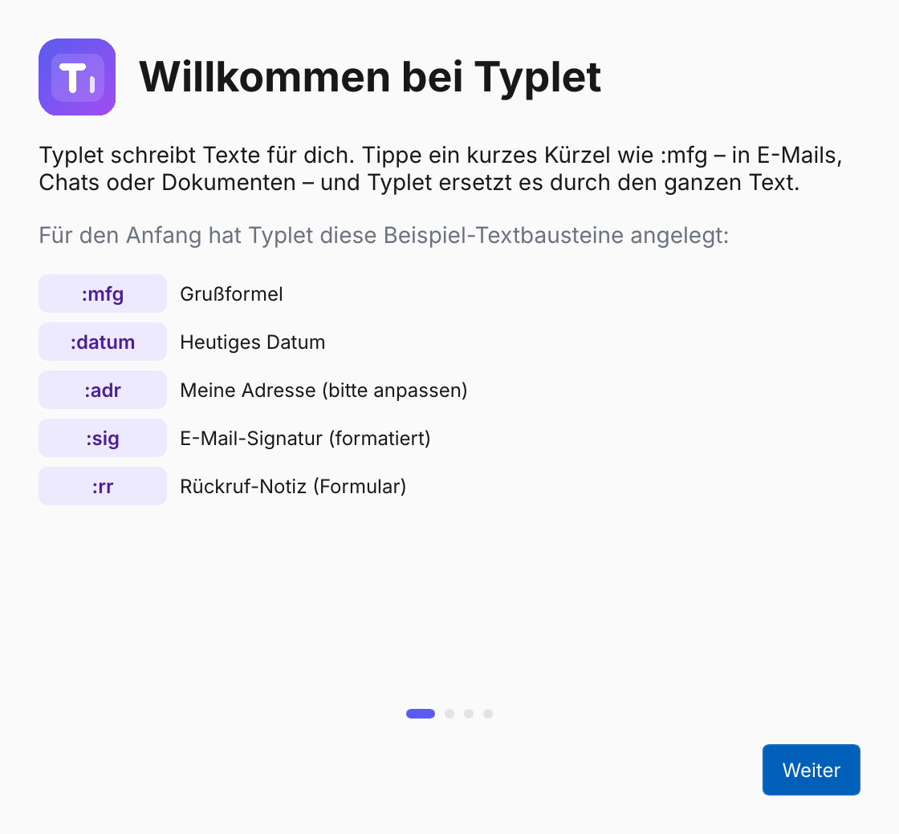
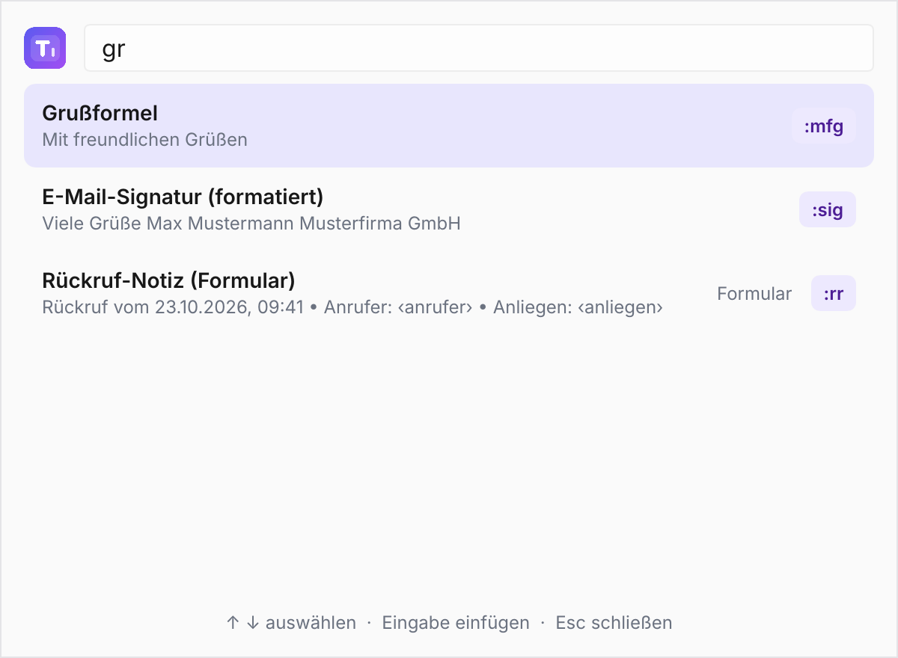
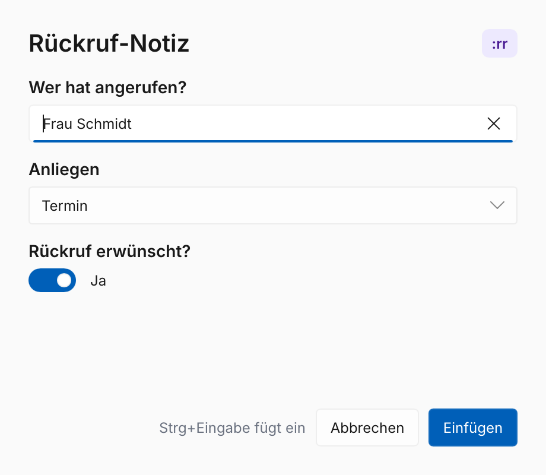
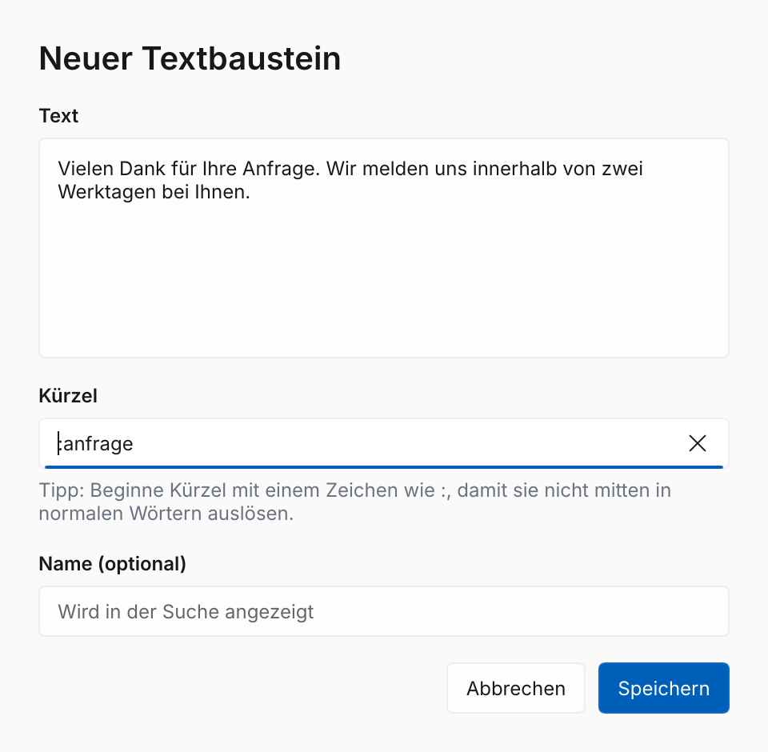
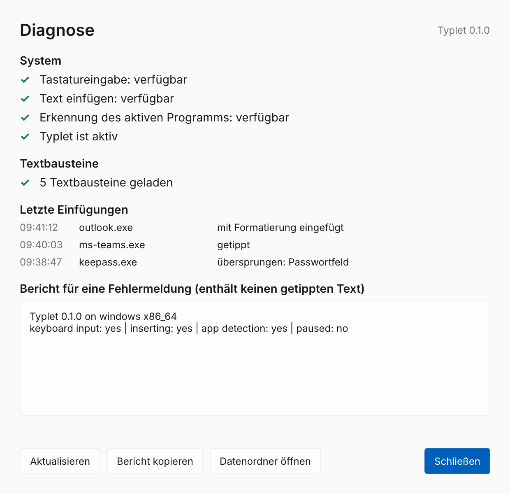

# 📖 Typlet-Anleitung

🇬🇧 [English guide](user-guide.md)

> Typlet wird gerade für die Beta vorbereitet. Ausprobieren kannst du [Testversionen](testing/test-build.md); Installationsprogramme folgen mit der Beta.

## Was Typlet macht

Du tippst ein kurzes **Kürzel** wie `:mfg`, und Typlet ersetzt es durch den ganzen Text – eine Grußformel, deine Adresse, eine formatierte Signatur, das heutige Datum oder ein kleines Formular zum Ausfüllen. Das funktioniert in jedem Programm: Browser, E-Mail, Word, Teams, WhatsApp und so weiter.

## Erster Start

Beim ersten Start öffnet sich der **Einrichtungsassistent**:

1. Er zeigt die Beispiel-Textbausteine, die Typlet für dich angelegt hat.
2. Er prüft, ob Typlet die Tastatur lesen und Text einfügen kann.
3. Du kannst es **ausprobieren**: Tippe das Beispiel-Kürzel ins Testfeld und sieh zu, wie Text daraus wird.
4. Du entscheidest, ob Typlet mit dem Computer startet.

Danach läuft Typlet unauffällig im Hintergrund. Du findest es als Symbol im **Infobereich neben der Uhr** (unter Windows ggf. auf den Pfeil **^** klicken).

## Textbausteine verwenden

Tippe einfach das Kürzel, egal wo. Der Text erscheint, sobald du das letzte Zeichen des Kürzels getippt hast.

- **Rückgängig:** Drücke direkt danach die Rücktaste, dann ist dein Kürzel wieder da.
- **Formatierter Text** (fett, Links, Listen) behält seine Formatierung in Programmen, die das können, und übernimmt die Schrift deines Dokuments.
- **Deine Zwischenablage bleibt erhalten:** Wenn Typlet lange Texte über die Zwischenablage einfügt, legt es danach zurück, was du kopiert hattest.
- **Passwortfelder** werden automatisch übersprungen (Windows).

### Tipps für gute Kürzel

- Beginne Kürzel mit einem Zeichen wie `:` (`:mfg`, `:adr`), damit sie nie mitten in normalen Wörtern auslösen.
- Kurz und einprägsam ist besser als lang: `:sig` statt `:meinesignatur`.

## Textbaustein finden: Schnellsuche

Kürzel vergessen? Drücke **Strg+Umschalt+Leertaste** (oder klicke auf das Symbol im Infobereich), tippe ein paar Buchstaben aus Name, Kürzel oder Text und drücke **Eingabe**. Typlet fügt den Text dort ein, wo du gerade geschrieben hast.

## Formulare

Manche Textbausteine fragen vor dem Einfügen nach Angaben, zum Beispiel fragt eine Rückruf-Notiz, wer angerufen hat. Fülle die Felder aus und klicke auf **Einfügen** (oder **Strg+Eingabe**). **Abbrechen** holt dein Kürzel zurück.

## Textbausteine anlegen

- **Aus beliebigem Text:** Text markieren, **Strg+Alt+S** drücken, Kürzel wählen, speichern. Das neue Kürzel funktioniert sofort.
- **Neuer Textbaustein** im Menü des Infobereichs macht dasselbe mit leerem Text.
- Der **Editor** (Menü → *Editor öffnen*) kommt mit dem nächsten Meilenstein: Formatierung, Datum, Formulare, Kategorien und Einstellungen in einem Fenster.

## Das Menü im Infobereich

| Eintrag | Was er macht |
|---|---|
| Textbausteine suchen … | Öffnet die Schnellsuche |
| Neuer Textbaustein … | Legt einen Textbaustein aus getipptem oder eingefügtem Text an |
| Editor öffnen | Öffnet den Editor (sobald installiert) |
| Ordner mit Textbausteinen öffnen | Zeigt, wo deine Textbausteine gespeichert sind |
| Typlet pausieren / fortsetzen | Stoppt und startet das Ersetzen; pausiert ist das Symbol grau |
| Mit dem Computer starten | Startet Typlet bei der Anmeldung |
| Einrichten und testen … | Öffnet den Einrichtungsassistenten erneut |
| Diagnose … | Zeigt, was Typlet sieht und was zuletzt passiert ist |
| Hilfe | Öffnet diese Anleitung |
| Typlet beenden | Beendet Typlet, bis du es wieder startest |

## Etwas funktioniert nicht?

Öffne **Diagnose** im Menü. Dort siehst du:

- ob Typlet die Tastatur lesen und Text einfügen kann,
- Textbausteine, die nicht geladen werden konnten,
- die letzten Einfügungen: in welchem Programm und ob getippt, eingefügt oder übersprungen wurde.

Häufige Ursachen:

| Problem | Lösung |
|---|---|
| In einem Programm passiert nichts | Das Programm läuft vielleicht als Administrator. Unsignierte Testversionen können dort nicht schreiben. |
| Zeilenumbrüche schicken Chatnachrichten ab | In Teams, WhatsApp, Slack, Discord, Signal und Telegram nutzt Typlet automatisch Umschalt+Eingabe. Sag uns Bescheid, wenn ein Chatprogramm fehlt. |
| Linux: kein Tastaturzugriff | Führe die Befehle aus dem Einrichtungsassistenten einmal aus, melde dich dann ab und wieder an. |
| Linux: kein Symbol im Infobereich | Dein Desktop braucht StatusNotifier-Unterstützung (GNOME: Erweiterung *AppIndicator*). |

Wenn du ein Problem meldest, nutze **Bericht kopieren** in der Diagnose und füge ihn in ein [GitHub-Issue](https://github.com/typlet-app/typlet/issues) ein. Der Bericht enthält nie, was du getippt hast.

## Datenschutz

Typlet muss sehen, was du tippst, um Kürzel zu erkennen. Es behält nur die letzten paar Zeichen im Speicher, speichert oder protokolliert nie, was du tippst, hat im Hintergrundprogramm keinen Internetzugriff und pausiert in Passwortfeldern.

## Wo deine Daten liegen

| | Windows | Linux |
|---|---|---|
| Textbausteine | `%APPDATA%\Typlet\data\snippets` | `~/.local/share/typlet/snippets` |
| Einstellungen | `%APPDATA%\Typlet\config\settings.json` | `~/.config/typlet/settings.json` |

Jeder Textbaustein ist eine kleine Datei. Sichere den Ordner mit den Textbausteinen, um sie zu behalten.
