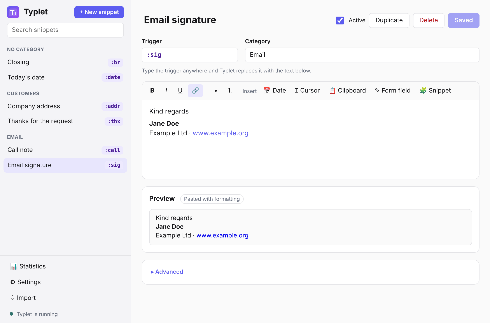
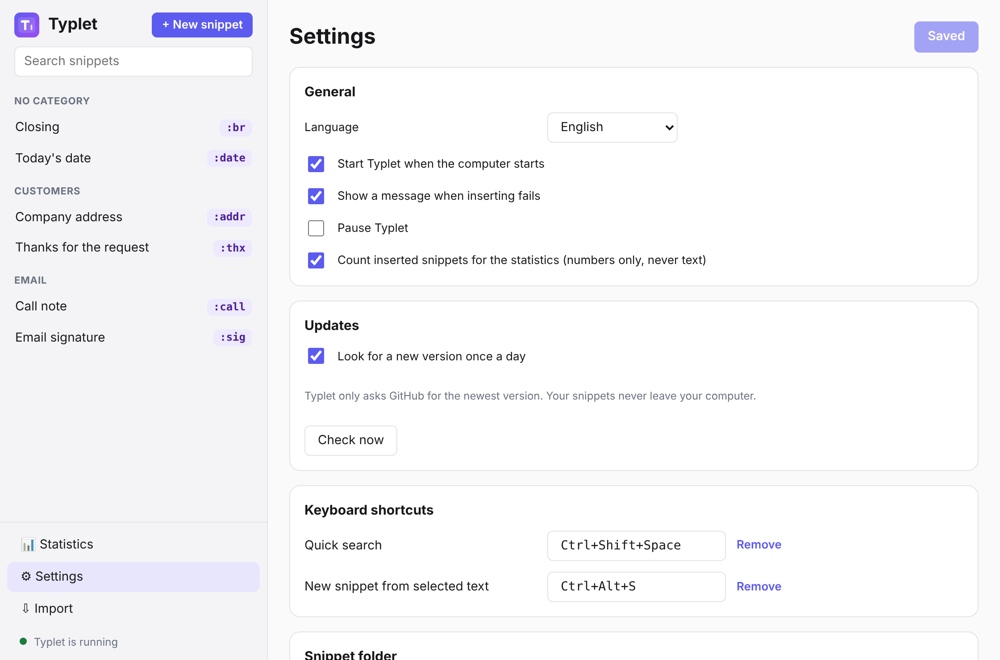
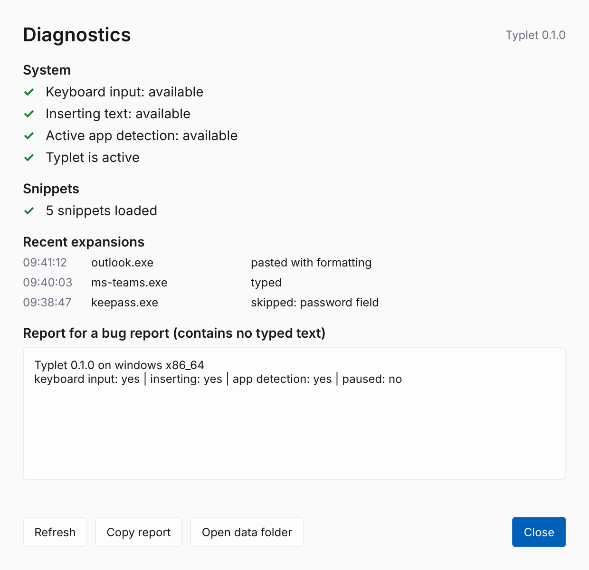

# 📖 Typlet user guide

🇩🇪 [Deutsche Anleitung](user-guide.de.md)

> Typlet is in beta. Please [report anything that does not work](https://github.com/typlet-app/typlet/issues/new/choose).

## What Typlet does

You type a short **trigger** such as `:mfg`, and Typlet replaces it with the full text — a greeting, your address, a formatted signature, today's date or a small form you fill in. It works in every app: browser, e-mail, Word, Teams, WhatsApp and so on.

## Installing

Download the installer for your system from the [releases page](https://github.com/typlet-app/typlet/releases).

**Windows 10/11:** run `Typlet_…_x64-setup.exe`. It installs Typlet for your user only and needs no admin rights. While Typlet is in beta it is not code-signed, so Windows warns about an unknown publisher: click **More info → Run anyway**.

**Ubuntu, Debian and similar:** install the `.deb` file, for example with `sudo apt install ./Typlet_…_amd64.deb`, then **log out and back in once** so Typlet may read the keyboard.

**Other Linux distributions:** make the `.AppImage` file executable and start it. The set-up assistant shows the commands for the one-time keyboard set-up.

To remove Typlet, uninstall it like any other program. Your snippets stay in your user folder (see [Where your data lives](#where-your-data-lives)).

## First start

When Typlet starts for the first time, the **set-up assistant** opens:

1. It shows the example snippets Typlet created for you.
2. It checks that Typlet can read the keyboard and insert text.
3. It lets you **try it**: type the example trigger in the test field and watch it turn into text.
4. You decide whether Typlet starts with your computer.

Afterwards Typlet runs quietly in the background. You find it as an icon in the **system tray next to the clock** (on Windows, click the **^** arrow if it is hidden).

## Using snippets

Just type the trigger anywhere. The text appears as soon as you type the last character of the trigger.

- **Undo:** press Backspace right after a snippet appeared to get your trigger back.
- **Formatted text** (bold, links, lists) keeps its formatting in apps that support it, and adopts the font of your document.
- **Your clipboard is safe:** if Typlet uses the clipboard to insert long text, it puts back what you had copied.
- **Password fields** are skipped automatically (Windows).

### Tips for good triggers

- Start triggers with a character such as `:` (`:mfg`, `:adr`), so they never fire inside normal words.
- Short and memorable beats long: `:sig` rather than `:mysignature`.

## Finding a snippet: quick search

Forgot a trigger? Press **Ctrl+Shift+Space** (or click the tray icon), type a few letters of its name, trigger or text, and press **Enter**. Typlet inserts it where you were typing.

## Forms

Some snippets ask for details before they are inserted, for example a call note asks who called. Fill in the fields and press **Insert** (or **Ctrl+Enter**). **Cancel** brings your trigger back.

## Creating snippets

- **From any text:** select it, press **Ctrl+Alt+S**, choose a trigger and save. The new trigger works immediately.
- **New snippet** in the tray menu does the same with an empty text.
- **In the editor** (tray menu → *Open editor*) you have every option.

## The editor

On the left are all your snippets, grouped by category, with a search field. Click one to edit it, or click **+ New snippet**.

- **Name** and **trigger** at the top. Typlet warns you straight away if another snippet uses the same trigger or if two triggers get in each other's way (for example `:c` and `:cc`).
- **Category** groups snippets, for example `E-Mail` or `Customers / Quotes`. Each category is a folder.
- **The text** is edited like in a word processor: bold, italic, underlined, links and lists.
- **Insert** adds placeholders, shown as coloured chips:
  - 📅 **Date** – today's date when the snippet is used. Click the chip to choose the format or shift it by days (tomorrow, in two weeks).
  - ⌶ **Cursor** – where the text cursor ends up after inserting.
  - 📋 **Clipboard** – whatever you copied last.
  - ✎ **Form field** – a question Typlet asks before inserting; the answer is put here.
- **Form** lists the questions: their wording, the type of answer (text, several lines, a choice, yes/no) and a pre-filled answer.
- **Preview** shows the text exactly as it will be inserted today, and whether it will be typed or pasted.
- **Advanced**: always type or always paste, and a keyboard shortcut that inserts the snippet without typing the trigger.

Press **Save** (or **Ctrl+S**). The background program picks up the change at once. While you type in the editor, triggers are not replaced.

### Settings

**Settings** (bottom left) holds the language, start with the computer, messages, the keyboard shortcuts, the snippet folder (choose a synced folder such as OneDrive to use your snippets on several computers) and **app rules**: switch Typlet off in a program, or change how it inserts text there.

### Coming from espanso?

**Import** (bottom left) takes over your espanso snippets, including dates, the clipboard, forms and formatted text. Your espanso files are not changed. Snippets that run scripts or use regular expressions are listed as not imported.

## The tray menu

| Entry | What it does |
|---|---|
| Search snippets… | Opens the quick search |
| New snippet… | Creates a snippet from text you type or paste |
| Open editor | Opens the editor |
| Open snippet folder | Shows where your snippets are stored |
| Pause / Resume Typlet | Stops and restarts expanding; the icon turns grey while paused |
| Start with the computer | Starts Typlet when you log in |
| Set up and test… | Opens the set-up assistant again |
| Diagnostics… | Shows what Typlet sees and what happened recently |
| Help | Opens this guide |
| Quit Typlet | Ends Typlet until you start it again |

## Something does not work?

Open **Diagnostics** from the tray menu. It shows:

- whether Typlet can read the keyboard and insert text,
- snippets that could not be loaded,
- the last expansions: in which app, and whether the text was typed, pasted or skipped.

Common causes:

| Problem | Solution |
|---|---|
| Nothing happens in one program | That program may run as administrator. Unsigned test builds cannot type into it. |
| Line breaks send chat messages | Typlet uses Shift+Enter in Teams, WhatsApp, Slack, Discord, Signal and Telegram automatically. Tell us about other chat apps. |
| Linux: keyboard access missing | Run the commands shown in the set-up assistant once, then log out and back in. |
| Linux: no tray icon | Your desktop needs StatusNotifier support (GNOME: *AppIndicator* extension). |

When you report a problem, use **Copy report** in Diagnostics and paste it into a [GitHub issue](https://github.com/typlet-app/typlet/issues). The report never contains anything you typed.

## Privacy

Typlet has to see what you type to recognise triggers. It keeps only the last few characters in memory, never saves or logs what you type, has no internet access in the background program and pauses in password fields.

## Where your data lives

| | Windows | Linux |
|---|---|---|
| Snippets | `%APPDATA%\Typlet\data\snippets` | `~/.local/share/typlet/snippets` |
| Settings | `%APPDATA%\Typlet\config\settings.json` | `~/.config/typlet/settings.json` |

Each snippet is one small file. Back up the snippets folder to keep your snippets safe.
